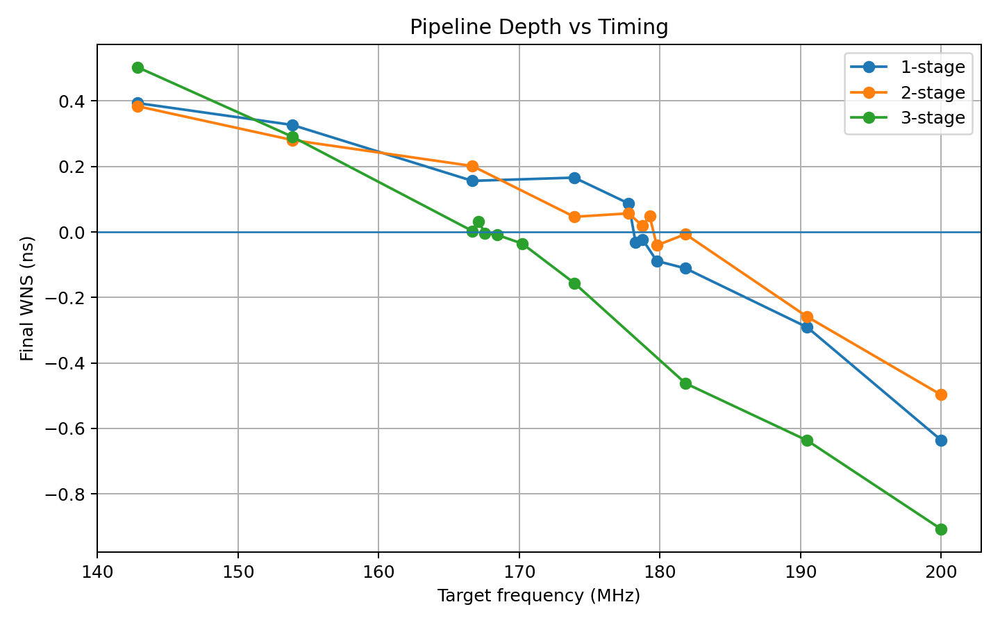
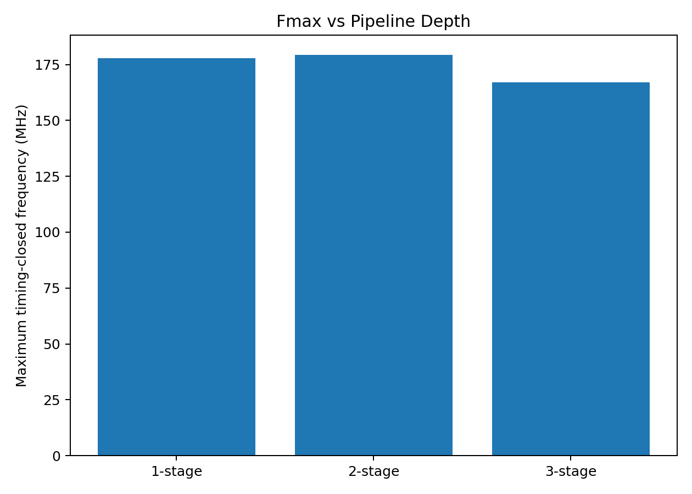
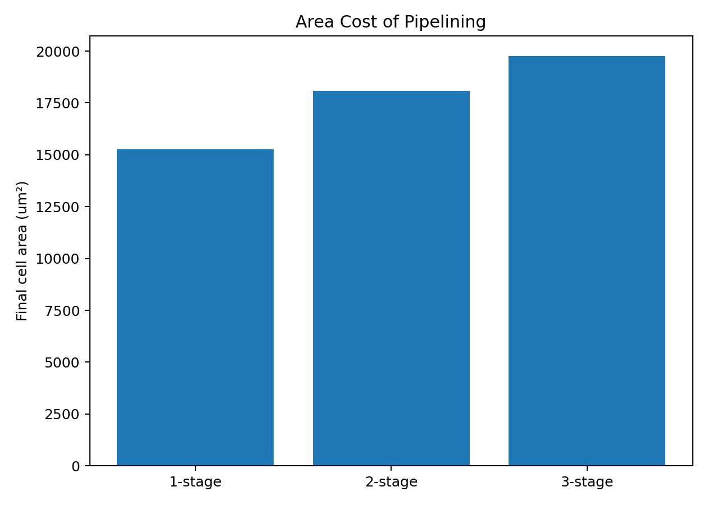
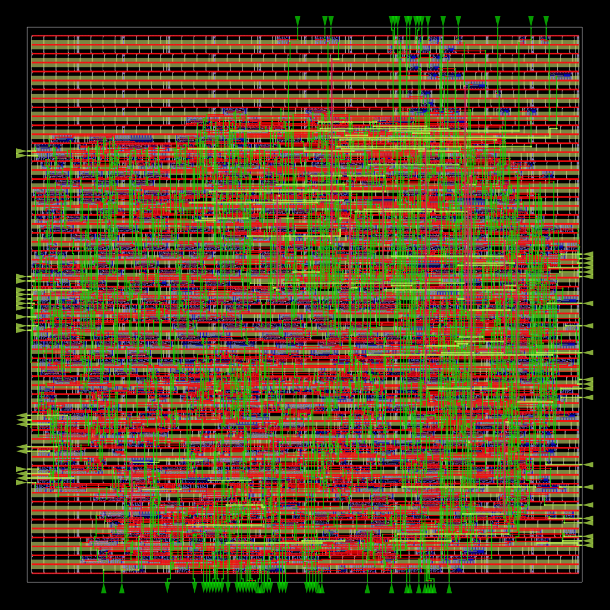
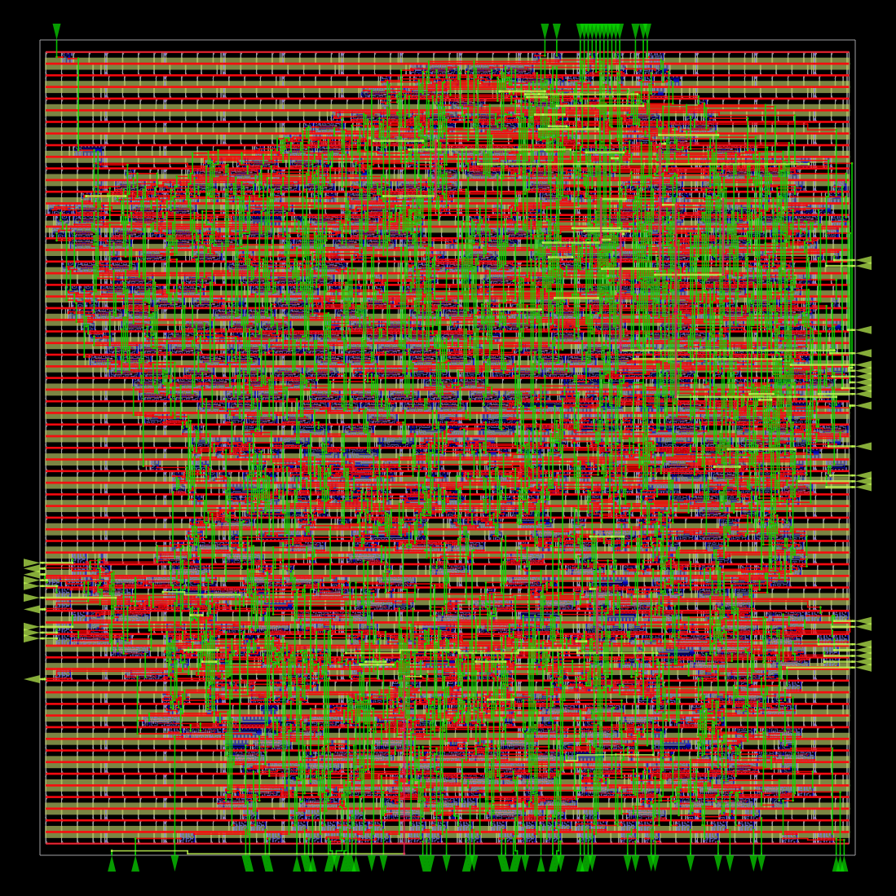
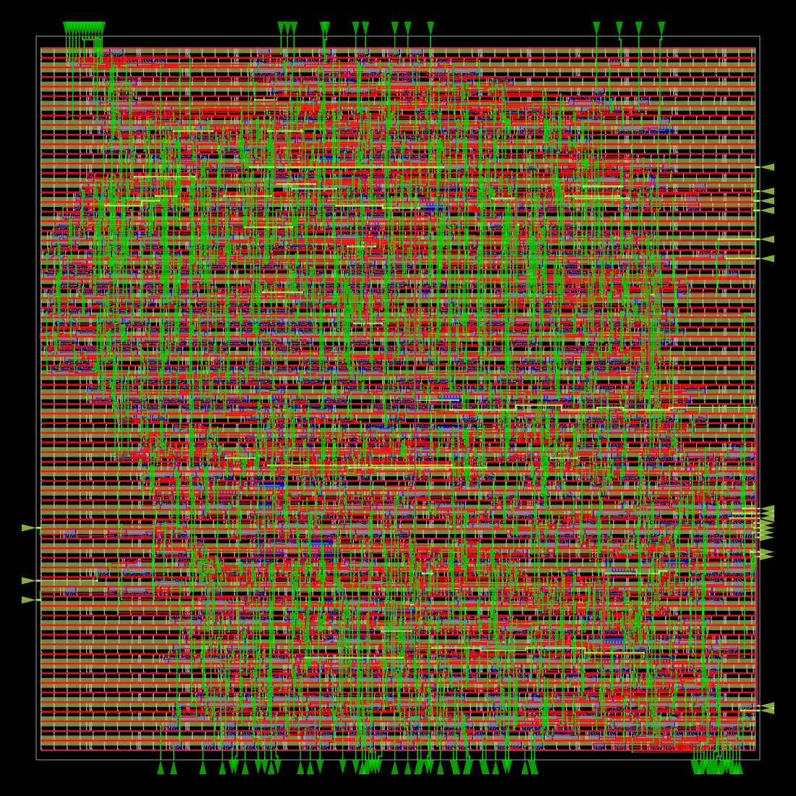
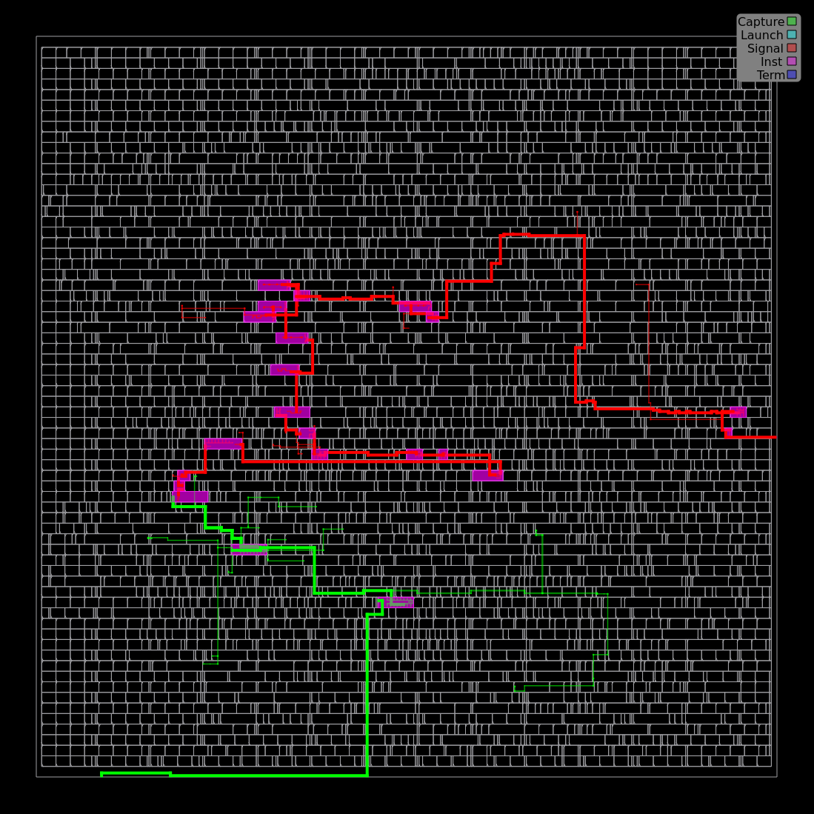

cat > README.md <<'EOF'
# Pipelined MAC: RTL-to-GDS Design-Space Exploration

A parameterized signed multiply-accumulate (MAC) unit implemented in SystemVerilog and evaluated across **1-stage, 2-stage, and 3-stage elastic pipeline microarchitectures**.

This project covers the complete digital IC design flow:

**RTL → randomized verification → synthesis → floorplanning → placement → CTS → routing → post-route STA → GDS → automated Fmax exploration**

The main objective is to study how pipeline depth affects:

- maximum clock frequency;
- latency;
- area;
- sequential-cell overhead;
- physical implementation.

---

## Key Result

The **2-stage implementation achieved the highest timing-closed frequency: 179.27 MHz**.

| Variant | Latency | Best Period | Fmax | WNS | Final Cell Area |
|---|---:|---:|---:|---:|---:|
| 1-stage | 1 cycle | 5.6250 ns | 177.78 MHz | +0.0870 ns | 15,272 µm² |
| **2-stage** | **2 cycles** | **5.5781 ns** | **179.27 MHz** | **+0.0484 ns** | **18,086 µm²** |
| 3-stage | 3 cycles | 5.9844 ns | 167.10 MHz | +0.0324 ns | 19,754 µm² |

All three implementations support a peak throughput of:

**1 operation per cycle**

once the pipeline is filled.

The main conclusion is:

> Increasing pipeline depth only improves Fmax when the new pipeline boundary actually partitions the critical combinational path.

---

# MAC Operation

The unit computes:

```text
y = a × b + c
```

using signed two's-complement arithmetic.

Default configuration:

```systemverilog
DATA_W = 16
ACC_W  = 32
```

The design is parameterized so operand and accumulator widths can be changed.

---

# Interface

The design uses an elastic `valid/ready` streaming interface.

```text
Inputs:
    clk
    rst_n

    in_valid
    out_ready

    a[DATA_W-1:0]
    b[DATA_W-1:0]
    c[ACC_W-1:0]

Outputs:
    in_ready
    out_valid

    y[ACC_W-1:0]
```

An input transaction is accepted when:

```text
in_valid && in_ready
```

An output transaction is consumed when:

```text
out_valid && out_ready
```

If the consumer deasserts `out_ready`, backpressure propagates through the pipeline without dropping or reordering transactions.

---

# Microarchitectures

## 1-Stage MAC

The multiplication and addition are performed within one arithmetic pipeline stage.

```text
a ──┐
    × ─────┐
b ──┘      │
           + ───► output register ───► y
c ─────────┘
```

Critical arithmetic structure:

```text
MULTIPLIER → ADDER → REGISTER
```

### Characteristics

- latency: 1 cycle;
- peak throughput: 1 op/cycle;
- smallest implementation;
- smallest sequential-state overhead.

---

## 2-Stage MAC

The multiplication result is registered before accumulation.

```text
                Stage 1             Stage 2

a ──┐
    × ──► product register ──┐
b ──┘                        │
                             + ──► output register ──► y
c ─────► c register ─────────┘
```

Critical arithmetic partition:

```text
MULTIPLIER | ADDER
```

This architecture achieved the highest timing-closed Fmax.

### Characteristics

- latency: 2 cycles;
- peak throughput: 1 op/cycle;
- multiplier and adder are separated by a pipeline boundary.

---

## 3-Stage MAC

The third implementation adds an input-register stage.

```text
             Stage 1          Stage 2          Stage 3

a ──► reg ──┐
             │
b ──► reg ──┴──► MULT ─► reg ──┐
                                │
c ──► reg ─────────────► reg ───┴──► ADD ─► y
```

Pipeline structure:

```text
INPUT REGISTERS | MULTIPLIER | ADDER
```

The additional stage does not internally partition the multiplier.

As a result, it increases latency and implementation overhead without improving the dominant arithmetic path.

### Characteristics

- latency: 3 cycles;
- peak throughput: 1 op/cycle;
- largest sequential-state overhead.

---

# Verification

RTL verification is performed using **Icarus Verilog** and a self-checking SystemVerilog testbench.

The verification environment includes:

- positive signed operands;
- negative signed operands;
- zero values;
- boundary cases;
- randomized operands;
- randomized `in_valid`;
- randomized `out_ready`;
- downstream backpressure;
- transaction-order checking;
- reference-model comparison;
- output-stability checking during stalls;
- simulation timeout detection.

Each architecture is tested with:

```text
1000 randomized transactions
```

Run the complete regression:

```bash
./verification/run_all.sh
```

Expected output:

```text
TEST PASSED
Transactions generated : 1000
Transactions accepted  : 1000
Transactions received  : 1000
```

followed by:

```text
ALL REGRESSIONS PASSED
```

Waveforms are stored under:

```text
results/waves/
```

---

# Elastic Backpressure

If:

```text
out_valid = 1
out_ready = 0
```

the output stage must preserve the transaction.

If the stall continues:

```text
consumer stalls
       ↓
output stage stalls
       ↓
previous pipeline stage stalls
       ↓
in_ready eventually becomes 0
```

The randomized verification environment continuously exercises this behavior.

The testbench checks that:

- no accepted transaction disappears;
- transactions remain ordered;
- no transaction is duplicated;
- output data remains stable while stalled.

---

# RTL-to-GDS Flow

Physical implementation uses:

- **Yosys**
- **OpenROAD Flow Scripts**
- **OpenROAD**
- **OpenSTA**
- **Sky130 HD**
- **Docker**

The implementation flow is:

```text
SystemVerilog RTL
        ↓
Yosys synthesis
        ↓
Floorplanning
        ↓
Placement
        ↓
Clock Tree Synthesis
        ↓
Routing
        ↓
Post-route STA
        ↓
DEF / SPEF / GDS
```

The physical-design environment uses:

```text
openroad/orfs:latest
```

Run the baseline physical flow with:

```bash
./physical/run_orfs.sh
```

---

# Initial 200 MHz Experiment

The first architectural comparison used the same clock constraint for every design:

```text
Period = 5.0 ns
Frequency = 200 MHz
```

Final timing results:

| Variant | Final WNS |
|---|---:|
| 1-stage | -0.636 ns |
| 2-stage | -0.497 ns |
| 3-stage | -0.908 ns |

None of the three implementations closed timing at 200 MHz.

However, the 2-stage architecture produced the smallest timing deficit.

Instead of estimating Fmax from a single failed timing point, the project therefore performs a full automated clock sweep.

---

# Automated Fmax Search

The clock sweep is performed with:

```bash
python3 scripts/clock_sweep.py
```

The script automatically:

1. generates different clock constraints;
2. runs the full RTL-to-GDS flow;
3. parses final STA results;
4. classifies each run as PASS or FAIL;
5. finds the timing-closure boundary;
6. refines the boundary using additional iterations;
7. stores the best timing-closed implementation.

A run is considered timing-clean when:

```text
WNS >= 0
```

Intermediate results are cached, allowing interrupted experiments to resume without repeating completed runs.

---

# Final Timing-Closed Results

| Variant | Best Period | Fmax | WNS | Area | Latency |
|---|---:|---:|---:|---:|---:|
| 1-stage | 5.6250 ns | 177.78 MHz | +0.0870 ns | 15,272 µm² | 1 |
| **2-stage** | **5.5781 ns** | **179.27 MHz** | **+0.0484 ns** | **18,086 µm²** | **2** |
| 3-stage | 5.9844 ns | 167.10 MHz | +0.0324 ns | 19,754 µm² | 3 |

---

# Timing Sweep



The horizontal zero-WNS boundary separates timing-clean and timing-violating implementations.

---

# Fmax Comparison



Relative to the 1-stage architecture:

```text
2-stage:
Fmax improvement ≈ +0.84%

3-stage:
Fmax change ≈ -6.0%
```

The 2-stage design therefore provides only a modest frequency improvement despite the additional pipeline stage.

The 3-stage architecture demonstrates that:

> More pipeline stages do not automatically result in a higher clock frequency.

---

# Area Comparison



At each architecture's best timing-closed point:

| Variant | Area | Relative to 1-stage |
|---|---:|---:|
| 1-stage | 15,272 µm² | baseline |
| 2-stage | 18,086 µm² | +18.4% |
| 3-stage | 19,754 µm² | +29.4% |

Therefore, the small Fmax improvement of the 2-stage implementation comes with a measurable physical-area cost.

---

# Sequential-State Overhead

During the fixed-constraint implementation experiment, the number of sequential cells was:

```text
1-stage :  33
2-stage :  98
3-stage : 163
```

The increase is approximately:

```text
+65 sequential cells per added stage
```

This matches the expected RTL register structure.

For example, the additional 2-stage state contains approximately:

```text
32-bit product register
32-bit c register
 1-bit valid state
---------------------
65 bits
```

This provides a useful correlation between RTL architecture and synthesized physical structure.

---

# Latency vs Throughput

| Variant | Latency | Peak Throughput |
|---|---:|---:|
| 1-stage | 1 cycle | 1 op/cycle |
| 2-stage | 2 cycles | 1 op/cycle |
| 3-stage | 3 cycles | 1 op/cycle |

Pipeline depth increases latency.

However, all implementations retain a peak throughput of one new MAC operation per clock cycle when no backpressure is present.

---

# Selected Physical Implementations

The best timing-closed physical implementation of each architecture is stored under:

```text
results/fmax/
```

including:

```text
6_final.gds
6_final.def
6_final.odb
6_final.sdc
6_final.spef
6_final.v
best_run.json
```

---

## 1-Stage Routing



---

## 2-Stage Routing



---

## 3-Stage Routing



---

# Worst-Path Visualization

The selected implementations preserve OpenROAD worst-path visualizations.

Example:



This allows STA results to be correlated with the physical placement and routing of the design.

---

# Engineering Conclusions

## 1. Pipeline depth alone does not determine Fmax

The 3-stage architecture contains more pipeline stages than the 2-stage implementation but achieves a lower maximum timing-closed frequency.

```text
2-stage: 179.27 MHz
3-stage: 167.10 MHz
```

The third stage adds input registers without partitioning the multiplier's internal combinational path.

---

## 2. Pipeline boundaries must partition real combinational work

The transition from:

```text
MULT + ADD
```

to:

```text
MULT | ADD
```

introduces a useful arithmetic pipeline boundary.

By contrast:

```text
REG | MULT | ADD
```

adds another stage without dividing the multiplier itself.

---

## 3. RTL intuition must be validated physically

RTL pipeline depth alone is insufficient to predict final timing.

Physical implementation introduces:

- cell delays;
- buffering;
- placement effects;
- clock-tree delays;
- routing parasitics;
- cell sizing;
- fanout;
- congestion.

Therefore, architectural conclusions in this project are based on **post-route STA**, not RTL-level timing assumptions.

---

## 4. Fmax is not the only architectural metric

The 1-stage implementation provides:

- lowest latency;
- smallest area;
- Fmax close to the 2-stage design.

The 2-stage implementation provides:

- highest measured Fmax;
- one additional cycle of latency;
- approximately 18.4% more area.

The 3-stage implementation provides:

- highest latency;
- largest area;
- lowest measured Fmax of the three variants.

This illustrates the importance of considering multiple PPA and architectural metrics rather than optimizing pipeline depth alone.

---

# Power Analysis Note

OpenROAD power estimates are collected during physical implementation.

However, power is not currently used as the main basis for architectural conclusions because the experiment does not yet use workload-derived switching activity.

A more rigorous future comparison could use:

```text
RTL simulation
      ↓
VCD / SAIF
      ↓
activity-aware power analysis
```

---

# Repository Structure

```text
pipelined-mac/
├── rtl/
│   ├── mac_1stage.sv
│   ├── mac_2stage.sv
│   └── mac_3stage.sv
│
├── tb/
│   └── tb_mac_compare.sv
│
├── verification/
│   └── run_all.sh
│
├── physical/
│   ├── constraints/
│   ├── orfs/
│   ├── run_orfs.sh
│   ├── work/
│   └── sweep_work/
│
├── scripts/
│   ├── collect_ppa.py
│   ├── clock_sweep.py
│   └── plot_sweep.py
│
├── results/
│   ├── ppa/
│   ├── clock_sweep/
│   ├── fmax/
│   └── waves/
│
└── README.md
```

---

# Reproducing the Project

## 1. RTL Verification

Requirements:

```text
iverilog
vvp
```

Run:

```bash
./verification/run_all.sh
```

---

## 2. Physical Implementation

Docker image:

```bash
docker pull openroad/orfs:latest
```

Run:

```bash
./physical/run_orfs.sh
```

---

## 3. Collect PPA Metrics

```bash
python3 scripts/collect_ppa.py
```

Outputs:

```text
results/ppa/ppa_summary.csv
results/ppa/ppa_summary.md
```

---

## 4. Run Clock Sweep

```bash
python3 scripts/clock_sweep.py
```

Outputs include:

```text
results/clock_sweep/clock_sweep.csv
results/clock_sweep/clock_sweep.md
results/clock_sweep/fmax_summary.md
```

---

## 5. Generate Plots

```bash
python3 scripts/plot_sweep.py
```

Generated plots:

```text
results/clock_sweep/frequency_vs_wns.png
results/clock_sweep/fmax_comparison.png
results/clock_sweep/area_comparison.png
```

---

# Possible Extensions

Potential extensions include:

- activity-based power analysis using VCD/SAIF;
- internal multiplier pipelining;
- formal verification of the valid/ready protocol;
- saturation arithmetic;
- configurable accumulator behavior;
- vector dot-product unit;
- systolic MAC array;
- matrix-multiplication accelerator;
- utilization sweeps;
- multiple standard-cell libraries;
- voltage/frequency experiments;
- multi-corner STA.

A particularly interesting next experiment would be to **pipeline the multiplier internally**.

Unlike the current 3-stage design, this would partition the actual dominant combinational block and could provide a substantially larger Fmax improvement.

---

# Toolchain

- SystemVerilog
- Icarus Verilog
- Yosys
- OpenROAD Flow Scripts
- OpenROAD
- OpenSTA
- Sky130 HD
- Docker
- Python
- Matplotlib

---

# Summary

This project demonstrates a complete small-scale digital IC design workflow:

```text
microarchitecture
      ↓
RTL
      ↓
randomized verification
      ↓
synthesis
      ↓
physical implementation
      ↓
post-route STA
      ↓
GDS
      ↓
automated design-space exploration
```

The primary result is that the **2-stage MAC achieved the highest timing-closed frequency at 179.27 MHz**.

At the same time, the experiment shows that deeper pipelining is not automatically beneficial: the 3-stage implementation increased latency and physical overhead without partitioning the dominant arithmetic path, resulting in a lower Fmax.
EOF
