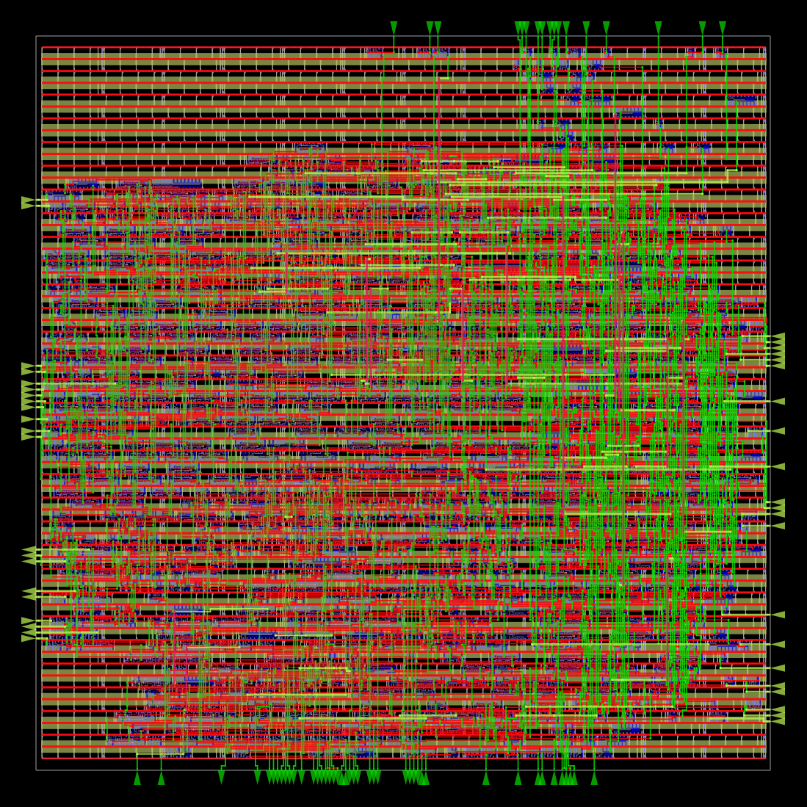
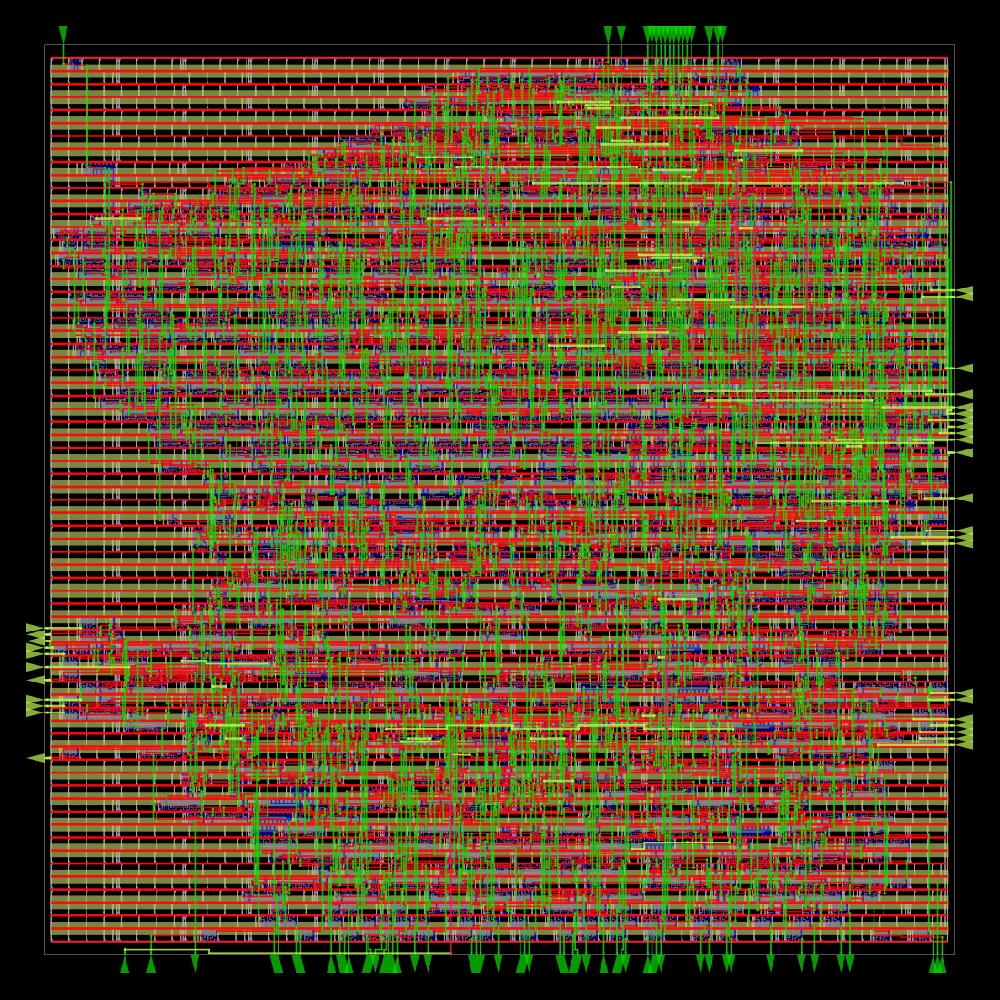
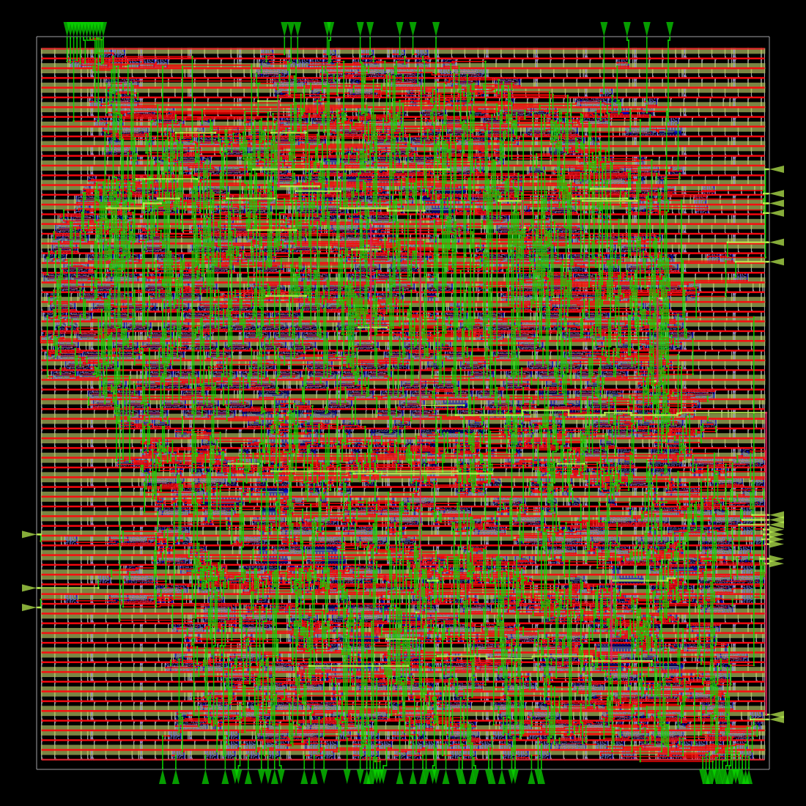

# MAC design and measurement guide

[Project overview and result table](../README.md)

## Arithmetic and interface

Each transaction computes `y = a * b + c` with signed two's-complement
operands. The product is `2*DATA_W` bits. It is sign-extended or truncated to
`ACC_W`, then added to the transaction's `c`. The output wraps to `ACC_W`
bits; there is no saturation or persistent accumulator state.

The active-low `rst_n` asynchronously clears valid bits and pipeline state.
An input is accepted at a rising clock edge with `in_valid && in_ready`.
An output is consumed at a rising edge with `out_valid && out_ready`.
A pending output must retain its value and validity while the consumer stalls.

| Variant | Arithmetic stages | Unstalled latency |
|---|---|---:|
| [`mac_1stage`](../rtl/mac_1stage.sv) | Multiply and add, then output register | 1 cycle |
| [`mac_2stage`](../rtl/mac_2stage.sv) | Registered product and delayed `c`, then add | 2 cycles |
| [`mac_3stage`](../rtl/mac_3stage.sv) | Input registers, registered product/delayed `c`, then add | 3 cycles |

The third variant adds input registers; it does not split the multiplier
internally. This describes the RTL boundaries, not a proof that the multiplier
is the worst post-route path in every implementation. Timing explanations
must be checked against each selected implementation's STA paths.

Elastic valid bits and ready propagation preserve transaction order. With no
stalls, the peak input rate is one operation per cycle for every variant;
adding stages changes latency rather than the arithmetic result.

## Verification scope

[`verification/run_all.sh`](../verification/run_all.sh) selects the three
current RTL modules using the `DUT` preprocessor definition and compiles the
shared [`tb_mac_compare.sv`](../tb/tb_mac_compare.sv) testbench.
It exercises 1000 transactions per variant, including directed boundary and
signed cases, random data, valid gaps and random output backpressure.
Accepted inputs enter a reference queue; consumed outputs are checked in
order. The bench also checks stable stalled outputs and detects timeouts.

The published regression uses `DATA_W=16`, `ACC_W=32`. Broader width coverage,
reset with outstanding transactions and formal protocol verification remain
separate tasks. The older `mac_2stage_old.sv` and `tb_pipelined_mac.sv` files
are outside the active runner; their presence does not identify another
measured variant.

## Physical experiment

The flow uses Yosys, OpenROAD Flow Scripts, OpenROAD/OpenSTA, SKY130 HD and
Docker. Each target proceeds through synthesis, placement, CTS, routing and
final timing analysis. The physical configs select the current RTL modules.

The [fixed constraint](../physical/constraints/mac_5ns.sdc) uses a 5 ns clock,
0.5 ns input/output delays for the data and handshake ports, and a false path
from `rst_n`. All three variants fail final setup timing at that target;
see the [200 MHz metrics](../results/ppa/ppa_summary.md).

The [sweep script](../scripts/clock_sweep.py) changes the period, runs the flow,
refines the observed passing/failing boundary and saves selected outputs.
Its PASS criterion is final setup WNS >= 0. Intermediate global-route slack
is a separate metric and must not be substituted for final setup slack.
The selected `6_report.json` files also report zero hold TNS and zero hold
violations; this is not a multi-corner signoff or measured silicon result.

Each period gets a separate implementation. The best tested passing target
is not an exact maximum operating frequency, and the result need not vary
monotonically with the requested clock. The 0.84% frequency difference is
small and was not assessed across repeated placement/routing runs.

Area comparisons use final cell area at each variant's own selected period.
They are not fixed-frequency area comparisons. In the separate fixed-5 ns
experiment, sequential-cell counts were 33, 98 and 163. The extra 65 bits per
stage agree with the default RTL state: a product or input payload, delayed
`c`, and a valid bit.

Power estimates in the reports do not use workload-derived switching
activity. They do not establish an energy-per-operation advantage.

## Saved evidence

- [Full sweep table](../results/clock_sweep/clock_sweep.md) and
  [machine-readable CSV](../results/clock_sweep/clock_sweep.csv).
- [Selected-period summary](../results/clock_sweep/fmax_summary.md).
- [1-stage record](../results/fmax/mac_1stage/best_run.json),
  [2-stage record](../results/fmax/mac_2stage/best_run.json),
  [3-stage record](../results/fmax/mac_3stage/best_run.json).
- Each selected directory contains final GDS, DEF, netlist, SDC, SPEF,
  `6_report.json`, `6_report.log` and `6_finish.rpt`.

The records are saved experiment outputs. Their values have not been
regenerated by this documentation update, and they do not contain a complete
source-hash or immutable container provenance record. Do not assign a digest
observed today to the historical runs retrospectively.

Selected routing images:







[2-stage worst-path image](../results/fmax/mac_2stage/final_worst_path.webp.png)

## Physical rerun commands and current limitations

The following are the existing flow commands, run from the repository root.
The physical runner, sweep and plotting scripts currently expect the clone
at `~/pipelined-mac`. Docker and the ORFS image are required for physical runs;
plotting additionally requires Python and Matplotlib.

```bash
bash physical/run_orfs.sh
python3 scripts/collect_ppa.py
python3 scripts/clock_sweep.py
python3 scripts/plot_sweep.py
```

`run_orfs.sh` uses `openroad/orfs:latest`, which is mutable. Reproducible new
measurements need a recorded image digest and tool revisions. This has not
been repaired by the documentation change, and no new physical run is claimed.
The sweep reuses cached JSON records without checking RTL/constraint/tool
hashes. Use fresh result directories for a changed experiment; old cache hits
are not new measurements. The sweep also rewrites `mac_sweep.sdc`.

Portability fixes, cache provenance and a pinned environment should precede
any new physical comparison. A follow-up experiment can then test whether an
internal multiplier boundary improves the trade-off under controlled inputs.
